<p align="center">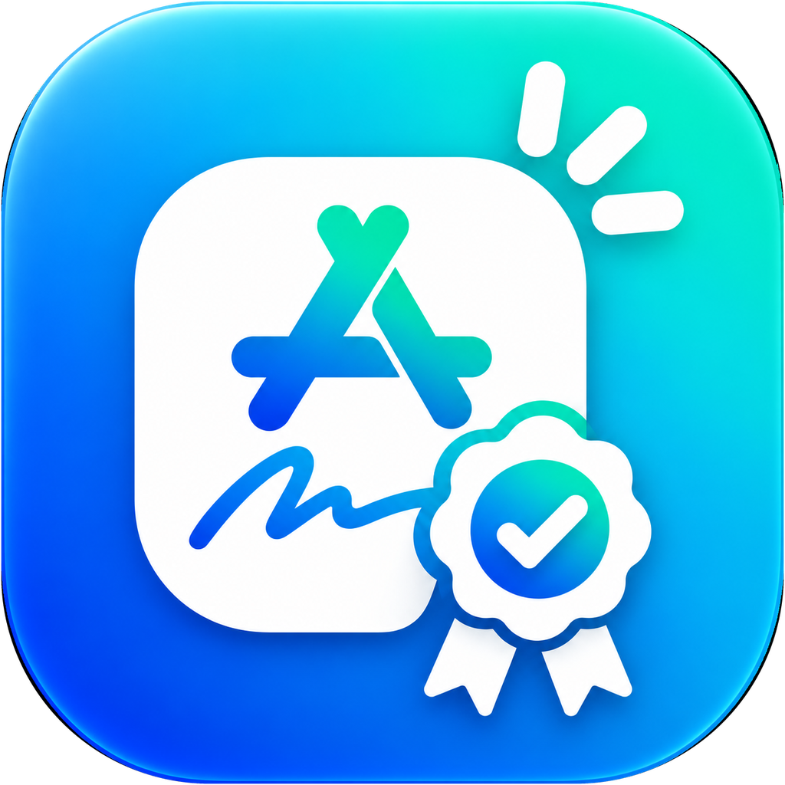</p>

<h1 align="center">一键签</h1>

<p align="center">用自己的 Apple ID 免费签名，或导入证书签名，把 App 一键装到 iPhone / iPad。<br>支持添加软件源，到期前自动续签，有新版自动更新，同一个 Wi‑Fi 下不用插线。</p>

<p align="center">
  <a href="https://oneduo.app/#download"><b>官网下载（Windows / Mac）</b></a> ·
  <a href="https://oneduo.app"><b>oneduo.app</b></a>
</p>

> ⭐ **点个 Star，再关注 [@81199000](https://github.com/81199000)，避免走失。** 官网 **[oneduo.app](https://oneduo.app)** 是长期固定入口，以后仓库再搬家也能从官网找到。

## 同系列项目

- **[DouDuo](https://github.com/81199000/DouDuo)**：第三方抖音客户端，原生 SwiftUI，适配折叠屏内屏 / iPad，推荐、评论、私信、直播都能用。
- **[GuoDuo](https://github.com/81199000/GuoDuo)**：红果短剧第三方客户端，原生播放，适配折叠屏内屏 / iPad，支持弹幕和选集。
- **[一键签 OneDuo](https://github.com/81199000/OneDuo)**（本项目）：Windows / Mac 装机工具，用自己的 Apple ID 免费把上面这些 App 签名装到手机，到期自动续签、有新版自动更新。
- 官网 **[oneduo.app](https://oneduo.app)**：三个项目的统一下载入口。

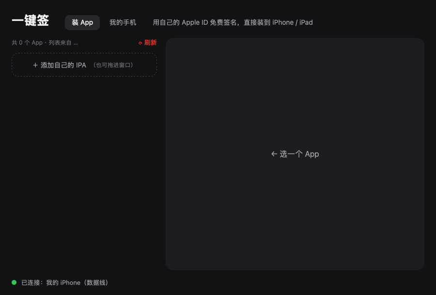

---

## 使用教程

### 1. 下载安装

到官网 **[oneduo.app](https://oneduo.app/#download)** 下载对应系统的安装包（下载慢可以用 [Gitee 备用下载](https://gitee.com/remon8/oneduo/releases)）。

**Windows 10 / 11（64 位）**：

1. 下载 `OneDuo-x.y.z-windows-x64-setup.exe`，双击运行。
2. 弹出蓝色的「**Windows 已保护你的电脑**」：点左边的 **更多信息**，再点出现的 **仍要运行**。
   > 一键签没有购买微软代码签名证书，所以 Windows 会提示一次，不是病毒。只有第一次安装会出现。
3. 弹出「你要允许此应用对你的设备进行更改吗？」：点 **是**。
4. 按安装向导点 **下一步** 到完成。建议保留「开机自动启动」，自动续签要靠它。

安装时会自动装好苹果手机驱动和 Bonjour（Wi‑Fi 找手机用），不需要另装 iTunes。

> 如果浏览器提示「不常下载」并拦住了下载：Edge 点下载列表里的 **⋯ → 保留 → 仍然保留**；Chrome 点 **保留**。
>
> 如果杀毒软件（360、火绒等）拦截，选 **允许** 或把它加入信任，再重新运行安装包。

**Mac（Apple 芯片和 Intel 都支持，macOS 11 及以上）**：下载 `OneDuo-x.y.z-macos-universal.zip`，解压后把「一键签」拖进「应用程序」，双击打开。已通过苹果公证，不会被系统拦截。

### 2. 连接手机

用数据线把 iPhone / iPad 连到电脑，解锁手机。弹出「要信任此电脑吗？」点 **信任**，输入锁屏密码。

连上后，窗口底部会显示手机名字。

### 3. 选 App，点一键安装

左边选要装的 App，右边点 **一键安装**。

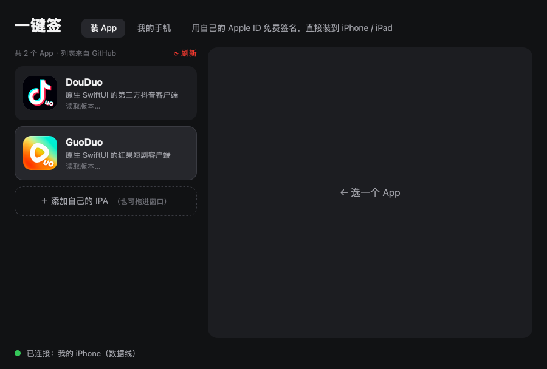

### 4. 登录 Apple ID

第一次安装要登录 Apple ID，之后会记住，不用每次输入。

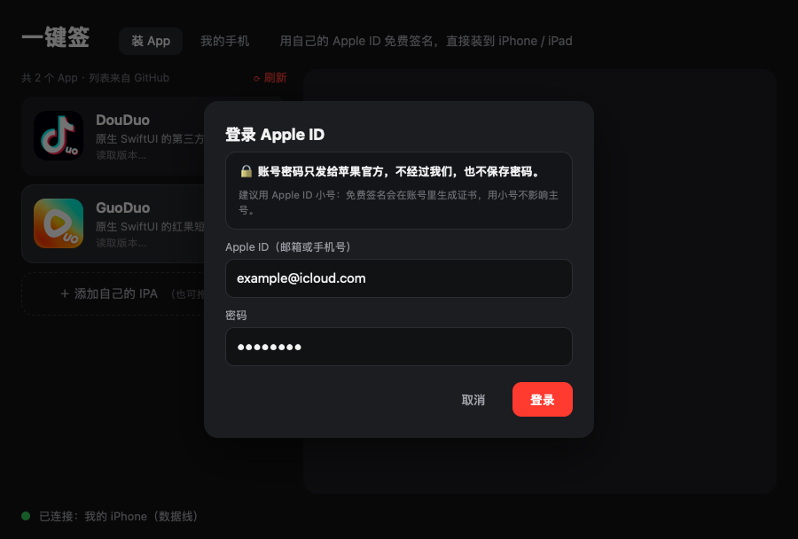

- 账号密码只发给苹果官方，不经过我们，也不保存密码。
- **建议用 Apple ID 小号**：免费签名会在账号里生成开发证书，用小号不影响主号的 iCloud 和购买记录。

### 5. 输入验证码

开了双重认证的账号会要验证码。苹果会推送到**登录着这个 Apple ID 的 iPhone / iPad / Mac**，在那台设备上点「允许」后会显示 6 位数字。

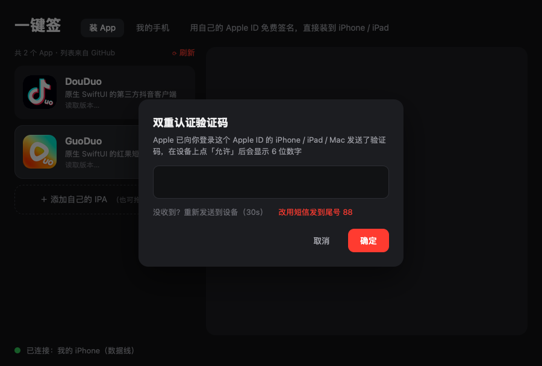

- 没弹出来：点 **重新发送到设备**。
- 小号没有登录在任何设备上：点 **改用短信发到尾号 xx**。

### 6. 等它装完

下载、签名、安装都是自动的，一般十几秒到一分钟。装的时候保持手机解锁，别拔线。

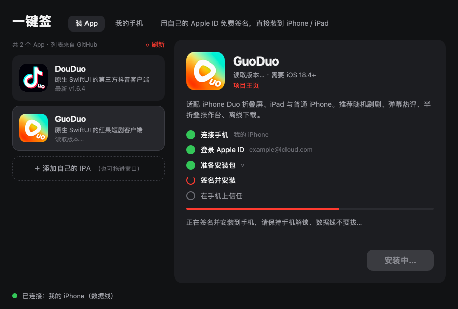

### 7. 在手机上信任

装完后第一次打开 App 前，在手机上：

1. **设置 → 通用 → VPN 与设备管理**，点你的 Apple ID，点 **信任**。
2. 如果提示需要开发者模式：**设置 → 隐私与安全性 → 开发者模式**，打开后按提示重启。

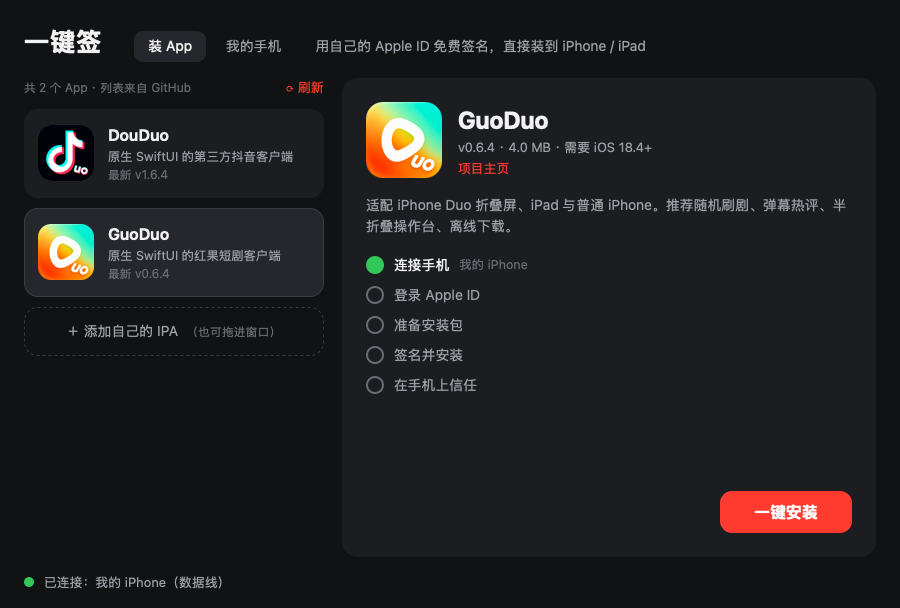

### 8. 自动续签、自动更新

免费 Apple ID 签的 App 只能用 **7 天**。一键签会记住你装过什么，在「我的手机」里显示每个 App 还剩几天。

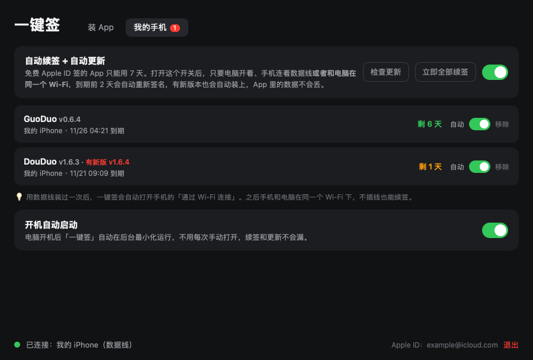

- **到期前 2 天自动重新签名**，App 里的数据不会丢。
- **有新版本自动装上**，也可以点「检查更新」马上查。
- **不用插线**：用数据线装过一次后，一键签会自动打开手机的「通过 Wi‑Fi 连接」。之后手机和电脑在同一个 Wi‑Fi 下就能续签。
- **开机自动启动**（安装时默认勾选）：电脑开着它就在后台挂着，续签不会漏。

### 9. 装自己的 IPA

不在列表里的 App，可以点左下角 **＋ 添加自己的 IPA**，或者直接把 `.ipa` 文件拖进窗口，然后同样点一键安装。

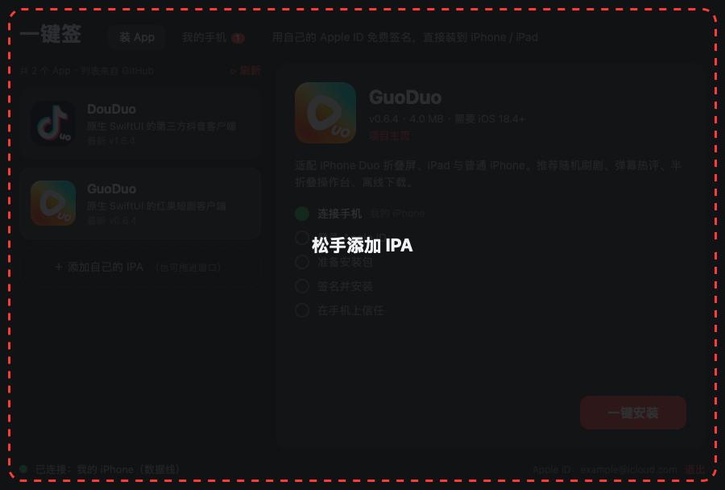

---

### 10. 添加软件源

和全能签的「软件源」用法一样。打开 **软件源与证书**，把源地址粘进去点 **添加**，源里的 App 就会出现在「装 App」列表里（按源分组，可以搜索），点一键安装自动下载、签名、装上。

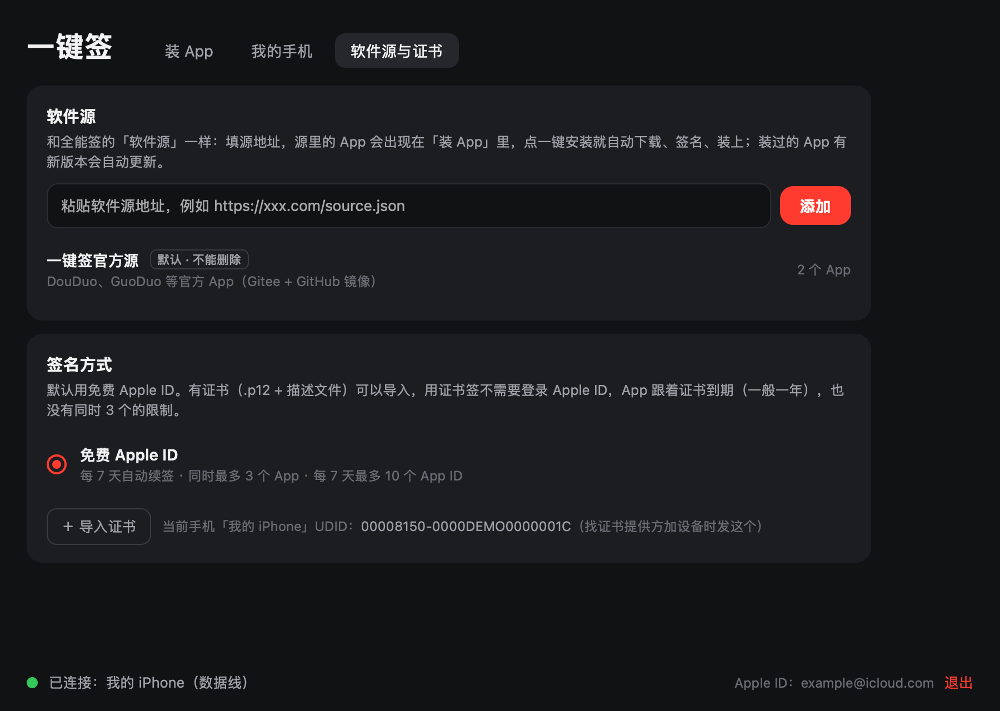

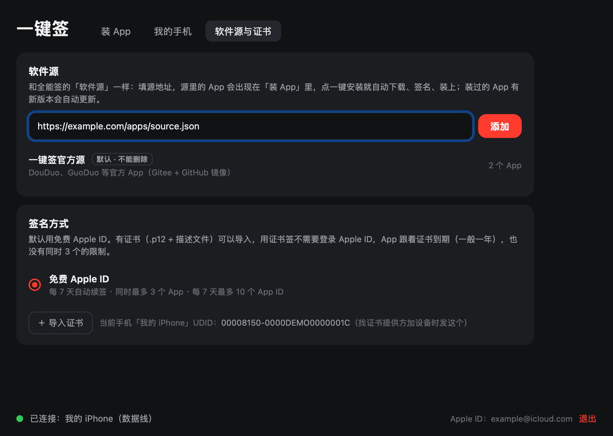

- 支持全能签 / ESign / AltStore / SideStore 的软件源格式。
- 「一键签官方源」（DouDuo）是默认源，固定在第一位，不能删除。
- 装过的 App 有新版本，会和官方 App 一样在后台自动更新。
- 需要解锁码的 App、网盘链接的 App 会显示「不支持」，不能直接装。

### 11. 用证书签名（全能签模式）

有证书的话（证书提供方给的 **.p12 证书 + 密码 + .mobileprovision 描述文件**），可以不用 Apple ID：

1. **软件源与证书 → 签名方式 → ＋ 导入证书**，选 .p12、填密码、选描述文件，点 **导入**。

   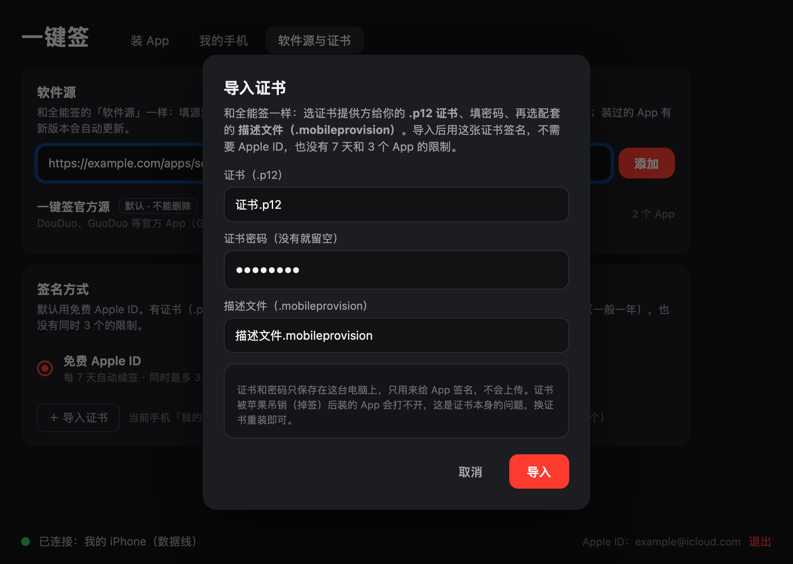

2. 一键签会检查证书和描述文件是否配套、有没有过期，导入后自动切到这张证书。可以随时在免费 Apple ID 和证书之间切换。

   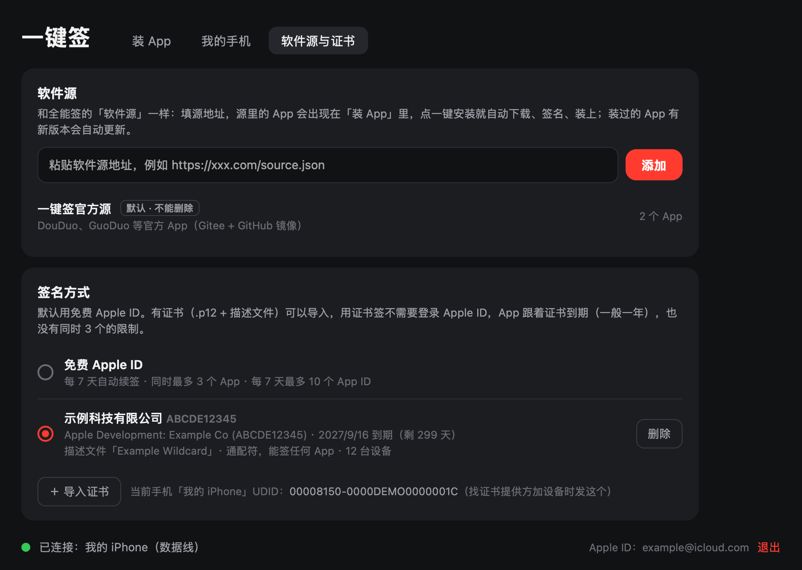

3. 之后点一键安装就用证书签名（不用登录 Apple ID）。证书签的 App 跟着证书到期（一般一年），没有 7 天和同时 3 个的限制；有新版本照样自动更新。

   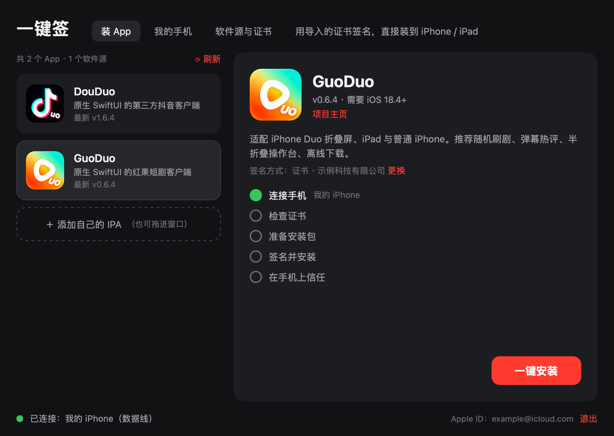

注意：

- 描述文件里要有你的手机。页面底部会显示当前手机的 UDID，发给证书提供方加进去。
- 描述文件绑定的是 **通配符（*）** 才能签任意 App；只绑定了某一个 App 的，只能签那一个。
- 证书被苹果吊销（掉签）后 App 会打不开，这是证书本身的问题，换一张证书重装即可。证书和密码只保存在你自己的电脑上。

### 12. 装到 NAS（电脑关机也能自动续签）

家里有 NAS 的话，可以把一键签装到 NAS 上。NAS 24 小时开着，手机回家连上 Wi‑Fi 就自动续签、自动更新，电脑可以关机。

1. 手机用数据线连电脑、解锁。打开一键签 →「我的手机」→ 最下面 **装到 NAS**。

   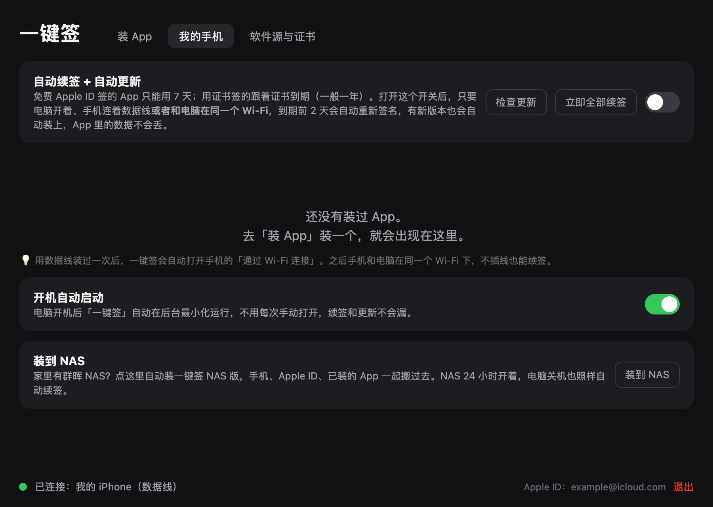

2. 一键签会自动找到家里的群晖（找不到就手动填 NAS 的 IP）。填 **NAS 的管理员账号和密码**，点 **开始安装**。开了两步验证的会再让你输验证码。

   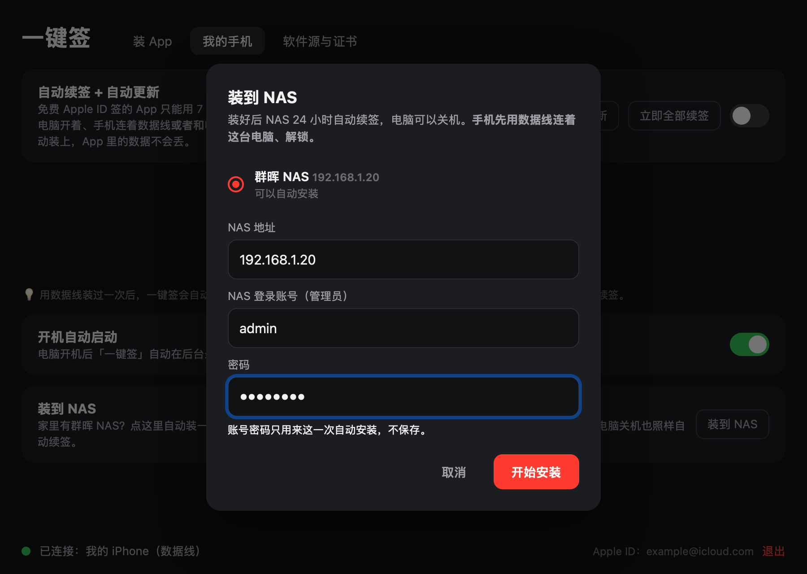

3. 等 1–2 分钟。一键签会自动：下载 NAS 版（约 57 MB，自动选 x86 / ARM）→ 传给 NAS → 在 Container Manager 里建 `oneduo` 项目并启动 → 把手机配对、Apple ID 登录、已装的 App 记录一起搬过去。NAS 不需要连 Docker Hub。

   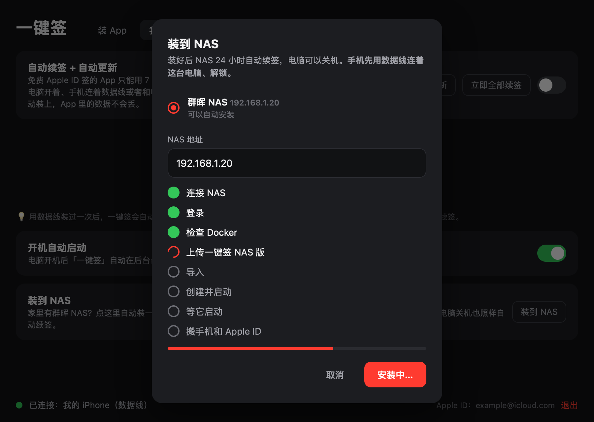

4. 装好后会自动打开 `http://NAS地址:8686`。以后在电脑或手机的浏览器里打开这个地址，装 App、看续签都在这里，界面和电脑版一样。

说明：

- **账号密码只用来这一次自动安装**，不保存。NAS 版只在家里局域网用；要映射到外网，在 Container Manager 里给 oneduo 加环境变量 `ONETAP_PASSWORD=你的密码`。
- 再点一次「装到 NAS」→「升级 / 重装」就是升级到最新版，数据保留。
- 需要 NAS 支持 Container Manager（Docker）。入门款（如部分 j / play 系列）不支持就装不了，继续用电脑版即可。
- 第一次必须用数据线连电脑：苹果要求手机先「信任」一台设备，这一步绕不开。之后就不用线了。

> **⚠️ 目前只在群晖（DS923+，DSM 7.4）上实测过。** 飞牛、威联通、绿联、极空间、Unraid 等其他 NAS 还没有测，「装到 NAS」的全自动安装也只支持群晖。
>
> 其他 NAS 可以手动装：下载 [`dl.oneduo.app/oneduo/nas/`](https://dl.oneduo.app/oneduo/nas/latest.json) 里对应架构的镜像，`docker load -i oneduo-nas-<版本>-<amd64|arm64>.tar.gz`，再用 [`nas/docker-compose.yml`](nas/docker-compose.yml) 启动（必须 `network_mode: host`），然后在电脑版点「装到 NAS」选这台 NAS 搬手机。
>
> **装不了？** 一键签是开源的。
> - 到 **抖音搜「一键签」** 给我们留言反馈：NAS 品牌型号、系统版本、卡在哪一步、报错截图。
> - 也可以让 AI 编程助手（Claude Code、Codex、Cursor 等）读本仓库的 [`nas/README.md`](nas/README.md) 和 [`py/app/nasinstall.py`](py/app/nasinstall.py)，按你的 NAS 改好后自己编译安装。改通了欢迎提 PR，让更多人能用。

## 常见问题

**App 打开就闪退**
签名过期了。打开一键签，在「我的手机」里点 **立即全部续签**。

**提示「同时最多 3 个」/ 装不上第 4 个**
免费 Apple ID 最多同时装 3 个自签 App。先在手机上删掉一个不用的，再装。

**提示「7 天内最多 10 个 App ID」**
免费 Apple ID 每 7 天最多给 10 个不同的 App 签名。过几天再装，或换一个 Apple ID。

**签名失败 / 验证失败**
先在手机 Safari 打开 [icloud.com](https://www.icloud.com)，用同一个 Apple ID 登录一次（同意条款、完成双重认证），再回来重新安装。

**找不到手机**
- 换一根数据线，或换个 USB 口。
- 手机解锁，重新点一次「信任」。
- Windows：重新运行一次安装包（会修复驱动）；还不行就重启电脑。

**装好的 App 跟原来的不是同一个**
免费签名时苹果要求包名加上你的团队后缀，所以会作为新 App 装上，跟别处装的原版并存。

---

## 自己编译

需要 Rust 和 Python 3.12+。

```bash
# Mac
cd py && ./build_mac.sh

# Windows 版签名组件（在 Mac 上交叉编译）
cargo build --release -p plumesign --target x86_64-pc-windows-gnu
# 然后在 Windows 上：
powershell -ExecutionPolicy Bypass -File py\packaging\build_win.ps1
```

应用列表在 [`catalog/apps.json`](catalog/apps.json)，加一个 App 只要往里加一条，不用改程序。

## 致谢

签名核心基于 [Impactor](https://github.com/claration/Impactor)（MIT 协议），感谢原作者。
